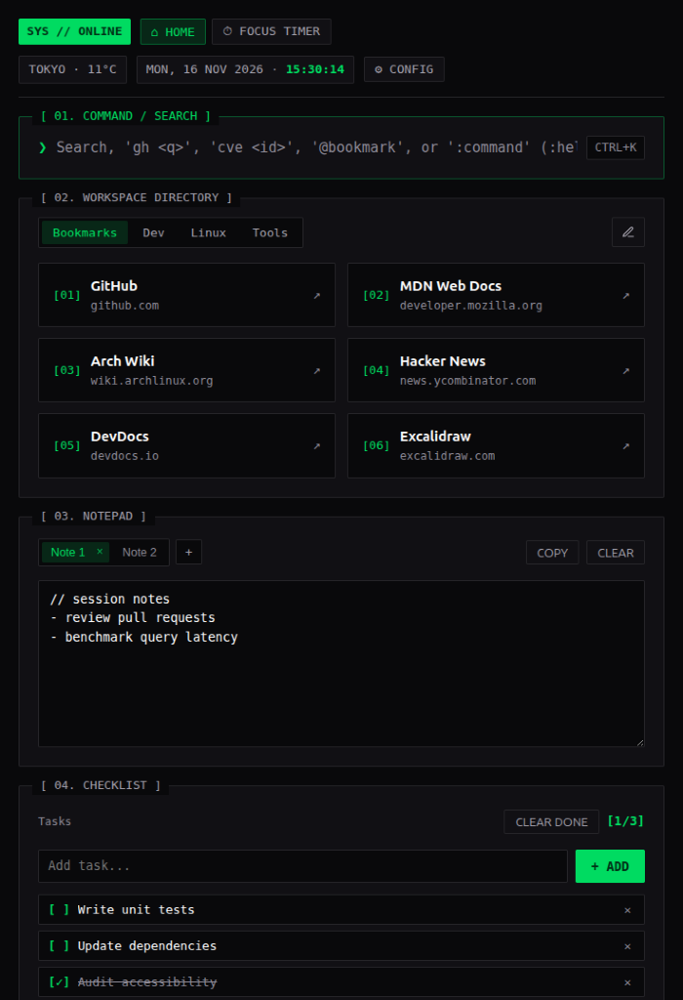
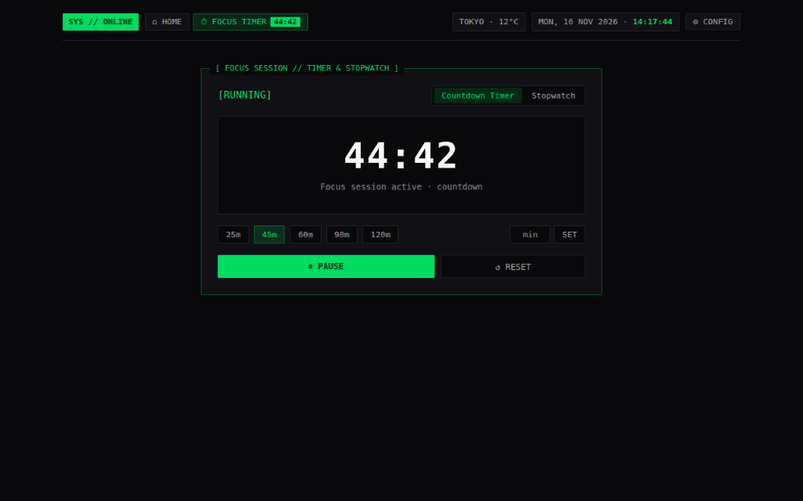
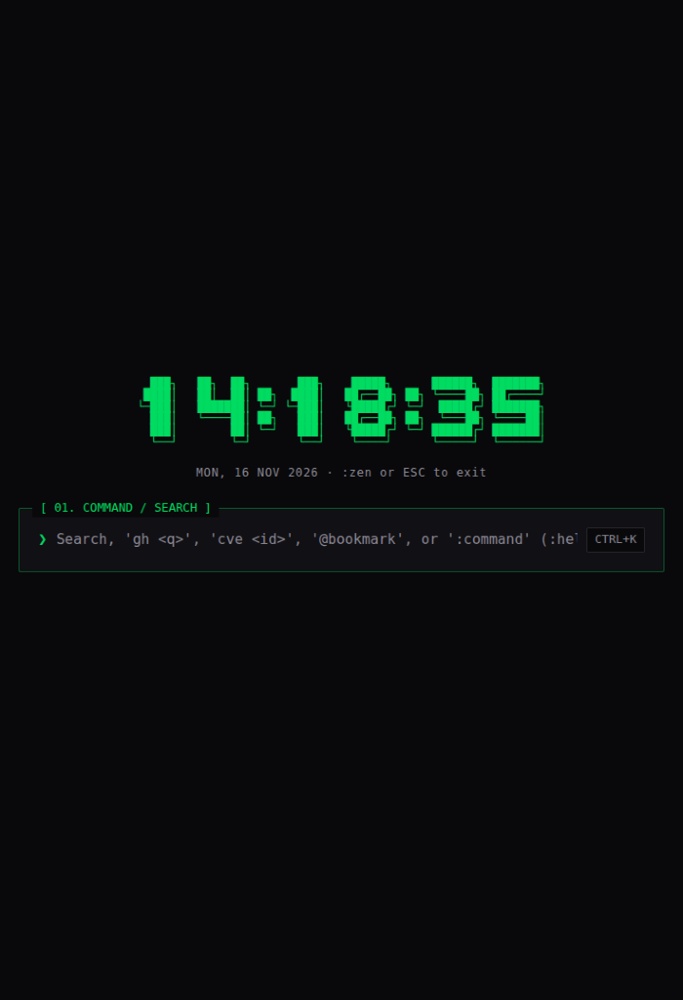

# cyber-home

Minimal TUI-inspired startpage (`SYS // HOME`) with command bar, bookmarks, notepad, checklist, and focus timer.



## Previews

### Focus Timer & Stopwatch


### Zen Mode (`:zen`)


## Quick Start

1. *(Optional)* Copy the defaults template for your private links and weather location (gitignored):
   ```bash
   cp config.example.js config.local.js
   ```
2. Open `index.html` directly or serve the folder locally:
   ```bash
   python3 -m http.server 8080
   ```

## Highlights

- **Command bar (`/` or `Ctrl+K`):** search prefixes (`g`, `gh`, `yt`, `ddg`, `cve`, `ht`, `crt`, `shodan`), `@` bookmark filter, and `:commands` (`:help`, `:zen`, `:timer`, `:theme`, `:font`, `:todo`, `:config`, `:export`).
- **Directory:** tabbed categories, `1–9` quick-open shortcuts, inline edit & drag-and-drop reorder.
- **Notepad & Checklist:** multi-tab notes (`Ctrl+Z` undo on clear) and persistent task checklist.
- **Themes & Scales:** `green`, `amber`, `cyan`, `violet` · `14px` / `16px` / `18px`.

## License

[BSD 3-Clause](LICENSE)
